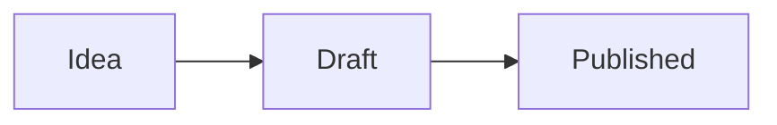

The first paragraph is the hook. Keep it short.

## Text

Plain text, **bold**, *italic*, `inline code`, a [link](https://jairzinhosantos.com) and a footnote[^1]. Lists work as usual:

- one idea per bullet
- or numbered steps

1. first
2. second

> A quote, for a sentence worth keeping.

## Images, SVG and animations

A paragraph with a single image becomes a figure. The quoted title is the caption.


Two or more images in one paragraph become a gallery:

 

## Video

A short clip from `media/` (mp4, webm or mov) gets a player:


A paragraph with only a YouTube URL becomes an embedded video:

https://www.youtube.com/watch?v=dQw4w9WgXcQ

## Diagrams



## Code

```python
def harness(prompt: str) -> str:
    return prompt.strip()
```

## Table

| Column | Meaning |
|---|---|
| date | sorts the list |
| status | draft or published |

[^1]: References go at the end, like this.
