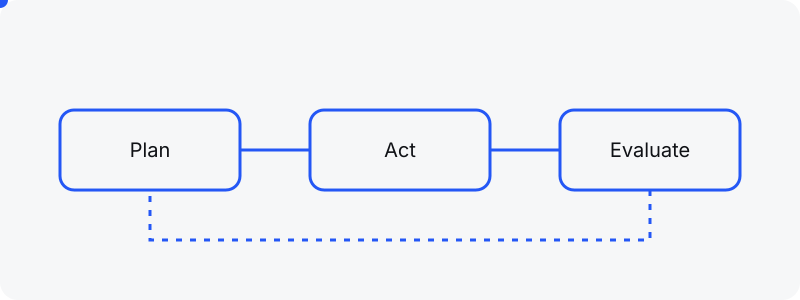
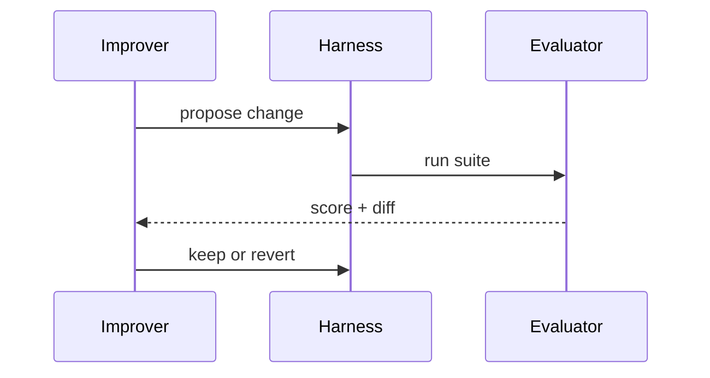
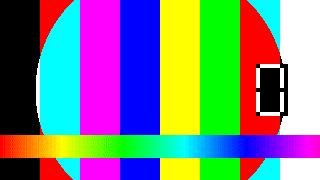
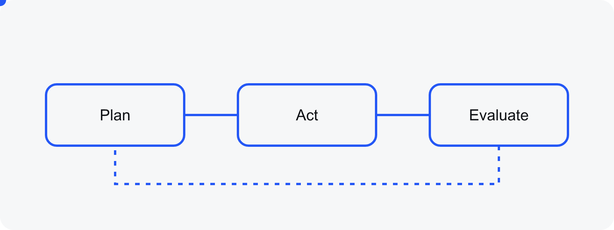

I started the thesis with a bounded case: a harness for a collections workflow, measured on quality, cost and review time. Three weeks in, the question underneath it was **more interesting than the case itself**.

The harness is the application layer around a model: instructions, tools, execution flow, memory, controls and evaluation. If an improver can modify that layer under *measurable constraints*, the harness becomes the object of study, not the workflow.[^1]

## The loop I want to break



Every iteration touches one of three surfaces. The table below is the version I will defend in the first committee review.

| Surface | What changes | How it is measured |
|---|---|---|
| Instructions | system prompt, policies | task pass rate |
| Tools | schemas, retries, routing | cost per solved task |
| Memory | what is kept between runs | review time |

> A harness that can rewrite itself is only useful if it can also tell you what it did and why. Otherwise it is a slot machine.

### Why "measurable" is the hard word

Here is the smallest evaluator that already says something:

```ts
export function score(run: Run): Score {
  const passed = run.tasks.filter(t => t.ok).length;
  return { passRate: passed / run.tasks.length, usd: run.cost, minutes: run.reviewMinutes };
}
```

And the sequence of a single improvement step:



## Media I will post along the way

Renders from Blender, short clips from the agents at work, and whatever helps explain a result. Everything embeds from the post itself.




Static screenshots too, side by side:




And a talk I keep coming back to:

https://www.youtube.com/watch?v=dQw4w9WgXcQ

## What I leave out on purpose

- No multi-agent choreography until a single loop is measurable.
- No fine-tuning: the harness is the variable, the model stays fixed.
- No benchmarks I cannot run on my own machine in under an hour.

[^1]: The framing follows the harness definition in the wiki chapter on agents. The measurement triad (quality, cost, review time) comes from the collections pilot.
